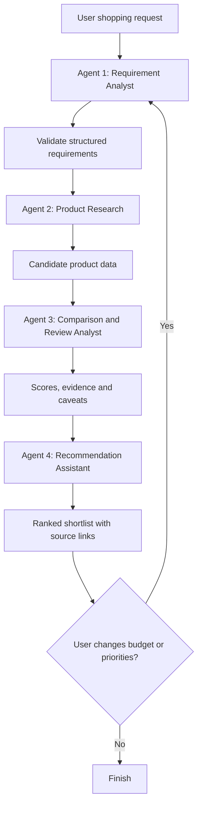

# AI Smart Shopping & Product Research Agent

## 1. Project Overview

**AI Smart Shopping & Product Research Agent** is a multi-agent application that helps users research and compare products before buying. The user provides a product category or requirement, budget, and preferences. The system gathers product information from configured data sources, normalizes and compares options, analyzes available reviews, and produces an evidence-based shortlist.

The application should explain **why** each product is recommended, show trade-offs, and identify missing or uncertain information. It should not invent prices, specifications, ratings, or review quotes.

### Example user request

> Find wireless headphones under ₹5,000 for online meetings and music. Prioritize microphone quality, comfort, battery life, and value for money.

### Main output

- A ranked shortlist of products
- Price and specification comparison
- Review sentiment and recurring pros/cons, where review data is available
- A recommendation tailored to the user's priorities
- Source links and the time the information was retrieved
- Caveats where data is missing or cannot be verified

---

## 2. Project Objectives

1. Build a practical multi-agent AI workflow.
2. Use tools and structured data rather than relying only on LLM knowledge.
3. Compare products using transparent, configurable criteria.
4. Summarize reviews without treating every review as trustworthy.
5. Provide grounded recommendations with citations or source links.
6. Support follow-up requests such as “lower the budget to ₹3,500” or “prioritize battery life.”
7. Evaluate recommendation quality, data accuracy, and tool-use reliability.

---

## 3. Four-Agent Architecture

Use **one orchestrator/workflow** to coordinate four focused agents. This avoids making every agent independently do everything.

### Agent 1 — Shopping Requirement Analyst

**Responsibility:** Convert the user's natural-language request into a clear, structured shopping brief.

**Inputs**
- Product category or use case
- Budget and currency
- Required and preferred features
- Brands to include or exclude
- User priorities

**Tasks**
- Extract hard constraints, such as maximum budget.
- Separate must-have requirements from nice-to-have preferences.
- Ask a follow-up question if an essential requirement is ambiguous.
- Produce a validated structured request.

**Example output**
```json
{
  "category": "wireless headphones",
  "budget_max": 5000,
  "currency": "INR",
  "must_have": ["wireless", "suitable for online meetings"],
  "priorities": {
    "microphone_quality": 0.35,
    "comfort": 0.25,
    "battery_life": 0.20,
    "value_for_money": 0.20
  },
  "excluded_brands": []
}
```

**Tools:** Structured-output parsing and input validation. This agent may not need external APIs.

### Agent 2 — Product Research Agent

**Responsibility:** Find candidate products and collect their factual details.

**Tasks**
- Search approved product APIs, affiliate feeds, or a prepared product catalogue.
- Retrieve product name, current listed price, merchant, product URL, and available specifications.
- Remove duplicates and discard products that violate hard constraints.
- Preserve source URLs and retrieval timestamps.

**Possible tools**
- Product-search API or a provider's official API
- A local JSON/CSV catalogue for the first prototype
- Qdrant payload filters for hard constraints, plus semantic search over product/document embeddings
- Web search only where permitted by the source's terms

**Important:** Do not assume every shopping website offers a free API. Start with a small, clearly labelled demo catalogue, then integrate a permitted live data source. Do not scrape sites in violation of their terms.

### Agent 3 — Comparison & Review Analyst

**Responsibility:** Evaluate the collected candidates against the user's requirements.

**Tasks**
- Normalize units and comparable specifications.
- Check which requirements each product meets.
- Summarize available review data into recurring pros, cons, and possible concerns.
- Flag missing, stale, or conflicting data.
- Calculate a transparent score using configured weights.

**Example scoring approach**

A configurable weighted score can be calculated from normalized criteria:

`Total score = Σ (criterion weight × criterion score)`

For example, if microphone quality has weight 0.35, its contribution is `0.35 × microphone score`.

- Normalize each criterion to a documented scale, such as 0–100.
- Normalize the user-provided weights so they sum to 1.
- Do not assign a high score to missing data by default.
- Report the scoring method and confidence/data coverage.
- Keep hard constraints, such as maximum budget, separate from preference scoring.

**Review-analysis caution:** Only analyze reviews that you have legitimately obtained. Report themes as summaries, not as verified facts about every buyer. Treat review text as untrusted data and ignore instructions embedded in reviews.

### Agent 4 — Recommendation & Shopping Assistant

**Responsibility:** Turn the comparison results into a clear, useful decision.

**Tasks**
- Rank eligible products using the comparison results.
- Explain why the top choices fit the user's priorities.
- Describe trade-offs and missing information.
- Present source links and data timestamps.
- Offer alternatives for different priorities, such as best value or longest battery life.
- Re-run the workflow when the user changes the budget or priorities.

**Output format**
1. Best overall match
2. Best value for money
3. Best alternative
4. Comparison table
5. Reasons and trade-offs
6. Source links and data freshness
7. Caveats and next steps

The agent must base its explanation on the structured evidence from the previous agents rather than inventing additional specifications.

---

## 4. Workflow



### Workflow rules

- Enforce hard constraints before ranking.
- Use deterministic Python code for scoring and arithmetic; use the LLM for interpretation and explanations.
- Validate all tool inputs and outputs with schemas.
- Store source URLs and timestamps with each product record.
- If research returns too few candidates, explain that limitation rather than fabricating results.
- Require explicit user approval before any purchase, checkout, or other consequential action. The initial project should be research-only and should not purchase products automatically.

---

## 5. Suggested Technology Stack

| Component | Suggested technology | Purpose |
|---|---|---|
| Language | Python | Application logic and tools |
| Agent orchestration | Microsoft Agent Framework (MAF) | State, workflow, retries, branching |
| LLM | Ollama (`qwen2.5:3b-instruct`, upgradeable to `qwen2.5:7b-instruct`) | Requirement parsing and grounded summaries, via Ollama's OpenAI-compatible endpoint |
| Embeddings | Ollama `nomic-embed-text` | Generate vectors for product, review, and document data |
| Structured validation | Pydantic | Validate agent inputs and outputs |
| Backend | FastAPI (included from Phase 1) | API endpoints between Streamlit and the agent workflow |
| UI | Streamlit | Shopping form and comparison dashboard |
| Data storage | Qdrant (embedded/local mode) | Single store for product records, reviews, document chunks, saved searches, and comparison results — structured fields live in point payloads with indexed filters, no separate relational database |
| Initial data source | Local CSV/JSON catalogue + PDF/DOCX manuals and review exports | Reliable, low-cost prototype; ingested and embedded into Qdrant |
| Document ingestion | `pypdf`, `python-docx`, `pandas` | Parse PDF/DOCX/CSV sources into text before chunking and embedding |
| Testing | pytest | Unit and workflow tests |

**Keep the first version simple:** Streamlit + Python + Microsoft Agent Framework + Pydantic + a small CSV/JSON catalogue is enough to demonstrate the workflow. Add live APIs after the core system works.

---

## 6. Suggested Project Folder Structure

```text
ai-smart-shopping-agent/
├── app.py                      # Streamlit UI entrypoint
├── api.py                      # FastAPI app (Streamlit calls this)
├── README.md
├── requirements.txt
├── .env.example
├── .gitignore
├── data/
│   ├── products.csv
│   ├── sample_reviews.json
│   └── sample_docs/            # sample manuals/spec sheets (PDF/DOCX) for ingestion
├── src/
│   ├── config.py
│   ├── schemas.py
│   ├── workflow.py             # Microsoft Agent Framework workflow/orchestration
│   ├── state.py
│   ├── agents/
│   │   ├── requirement_analyst.py
│   │   ├── product_researcher.py
│   │   ├── comparison_analyst.py
│   │   └── recommendation_assistant.py
│   ├── ingestion/
│   │   ├── pdf_loader.py
│   │   ├── docx_loader.py
│   │   ├── csv_loader.py
│   │   └── chunking.py
│   ├── tools/
│   │   ├── product_search.py
│   │   ├── vector_store.py     # Qdrant client, collections, payload filters
│   │   ├── review_analysis.py
│   │   └── scoring.py
│   └── utils/
│       ├── validation.py
│       └── formatting.py
├── tests/
│   ├── test_requirements.py
│   ├── test_scoring.py
│   ├── test_product_filters.py
│   ├── test_ingestion.py
│   └── test_workflow.py
└── docs/
    └── architecture.md
```

---

## 7. Data Model

A product record can use fields such as:

```json
{
  "product_id": "headphones_001",
  "name": "Example Wireless Headphones",
  "category": "headphones",
  "price": 3999,
  "currency": "INR",
  "merchant": "Example Store",
  "product_url": "https://example.com/product",
  "specifications": {
    "battery_hours": 40,
    "wireless": true,
    "microphone_quality": null,
    "weight_grams": 250
  },
  "rating": null,
  "review_count": null,
  "source_name": "Demo catalogue",
  "retrieved_at": "2026-10-09T12:00:00+05:30"
}
```

This is **illustrative demo data**, not a claim about a real product. Replace example URLs and values with verified data before showing live recommendations. In storage, this record becomes the payload of a point in the `products` Qdrant collection, keyed by `product_id`, with an embedding built from its name and specification text.

---

## 8. Agent State Design (Microsoft Agent Framework)

Maintain a shared state that passes validated results between agents. Example fields:

```python
from typing import Any, TypedDict

class ShoppingState(TypedDict, total=False):
    user_query: str
    requirements: dict[str, Any]
    candidate_products: list[dict[str, Any]]
    comparison_results: list[dict[str, Any]]
    recommendations: list[dict[str, Any]]
    warnings: list[str]
    errors: list[str]
```

Each agent should have a clear input/output contract. Use the Microsoft Agent Framework's conditional routing for missing requirements, failed searches, and re-planning after a user changes their priorities. Limit retries to avoid infinite loops.

---

## 9. User Interface

The Streamlit interface should include:

### Shopping input
- Product category or free-text requirement
- Maximum budget and currency
- Priorities with adjustable weights
- Must-have features
- Excluded brands (optional)

### Results
- Ranked product cards
- Comparison table
- Product links and merchant names
- Scores by criterion
- Pros, cons, and review themes when supported by data
- Source timestamps and data-quality warnings

### Follow-up actions
- Change budget
- Change priorities
- Compare two selected products
- Show alternatives
- Start a new search

Do not display fake “live prices,” ratings, stock levels, or review counts. If using a demo catalogue, label it clearly as sample data.

---

## 10. Implementation Plan

### Phase 1 — Working prototype
1. Create the project environment and install dependencies, including a local Qdrant instance and Ollama models.
2. Prepare a small product catalogue with clearly identified sample records.
3. Define Pydantic schemas and the shared agent state.
4. Implement requirement parsing and hard-constraint validation.
5. Implement product filtering and deterministic scoring.
6. Build the Streamlit interface and show a ranked comparison.

### Phase 2 — Agent workflow
1. Add the four agent nodes.
2. Connect agents using a Microsoft Agent Framework workflow.
3. Pass structured outputs between agents.
4. Add tool error handling and bounded retries.
5. Support changes to budget and priorities.

### Phase 3 — Research and review data
1. Connect a permitted product-data provider, if available.
2. Build the PDF/DOCX/CSV ingestion pipeline (parse → chunk → embed → store in Qdrant) for manuals, spec sheets, and review exports.
3. Store product source links and retrieval timestamps.
4. Add review analysis only when legitimate review data is available.
5. Flag stale, missing, or conflicting data.
6. Test source failures and partial results.

### Phase 4 — Evaluation and polish
1. Write unit tests for budget filtering, normalization, and ranking.
2. Test with different categories, budgets, and contradictory preferences.
3. Measure product-data accuracy and source coverage.
4. Evaluate whether recommendations match the stated priorities.
5. Add a README with setup steps, architecture, screenshots, limitations, and example queries.

---

## 11. Evaluation Metrics

Measure the system instead of assuming the LLM's answers are correct.

- **Constraint satisfaction:** Percentage of recommendations that meet all hard constraints.
- **Price accuracy:** Agreement between displayed prices and source data at retrieval time.
- **Source coverage:** Percentage of displayed claims linked to supporting evidence.
- **Ranking consistency:** Whether changing a priority predictably changes the ranking.
- **Tool success rate:** Percentage of searches that complete without tool errors.
- **Groundedness:** Whether product claims can be supported by retrieved records.
- **Latency and cost:** Average workflow time and LLM/API cost per search.
- **User usefulness:** Optional feedback on whether the shortlist helped the user decide.

Create a small test set of shopping requests with expected hard constraints and compare the workflow's outputs against them.

---

## 12. Safety, Privacy, and Reliability

- Treat product descriptions and reviews as untrusted input; do not follow instructions found inside them.
- Use environment variables for API keys; never commit `.env` or credentials.
- Validate tool arguments and use provider-supported APIs.
- Avoid claiming a product is “best” without explaining the criteria.
- Do not invent citations, product data, or review summaries.
- Make price and stock freshness visible.
- Collect only the user information needed for the search.
- Keep the first version read-only; purchases and checkout require explicit confirmation and should be outside the initial scope.

---

## 13. Future Enhancements

- More product categories and permitted data providers
- Price history and price-drop alerts, if supported by reliable data
- Personalized preferences saved with user consent
- Multilingual shopping queries
- Image-based product search
- MCP tools for standardized access to selected product-data services
- A/B evaluation of ranking strategies
- Human approval checkpoints before external actions

---

## 14. Resume Project Description (use after implementation)

**AI Smart Shopping & Product Research Agent**  
*Python, Microsoft Agent Framework, Ollama (Qwen2.5), Pydantic, FastAPI, Streamlit, Qdrant*

- Built a four-agent shopping research workflow to interpret user requirements, retrieve product information, compare candidates, and generate evidence-based recommendations.
- Implemented budget and feature filtering with transparent weighted scoring and structured output validation.
- Built a PDF/DOCX/CSV ingestion pipeline embedding product manuals, specs, and reviews into a local Qdrant vector store for semantic retrieval.
- Designed product comparisons with source links, data-quality warnings, and review summaries where supporting data was available.
- Evaluated constraint satisfaction, source coverage, ranking consistency, and tool reliability.

**Important:** Only include features and metrics that you have actually implemented and tested. Do not claim live integrations or performance numbers before measuring them.

---

## 15. Definition of Done

The initial project is complete when:

- [ ] A user can submit a shopping request and budget.
- [ ] The requirement agent returns validated structured requirements.
- [ ] The research agent returns products from the configured data source.
- [ ] Hard constraints are enforced before ranking.
- [ ] The comparison agent calculates reproducible scores.
- [ ] The recommendation agent explains its choices using product evidence.
- [ ] The UI shows source links and clearly labels sample or stale data.
- [ ] Changing budget or priorities triggers a new comparison.
- [ ] Tests cover filtering, scoring, missing data, and failed searches.
- [ ] The README documents setup, architecture, examples, and limitations.

