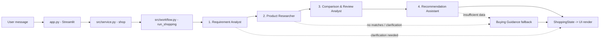
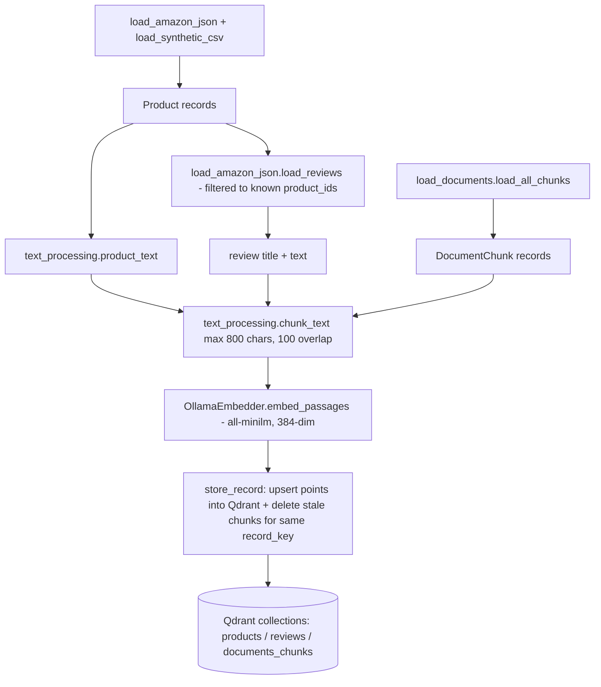
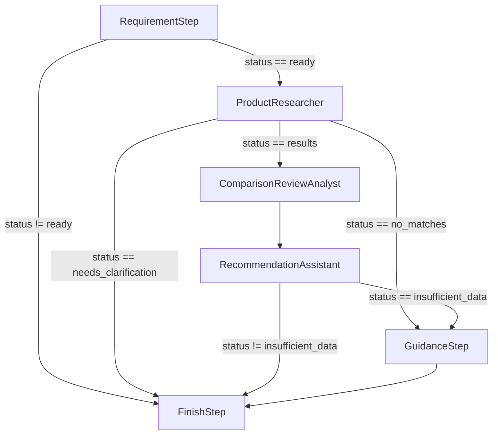
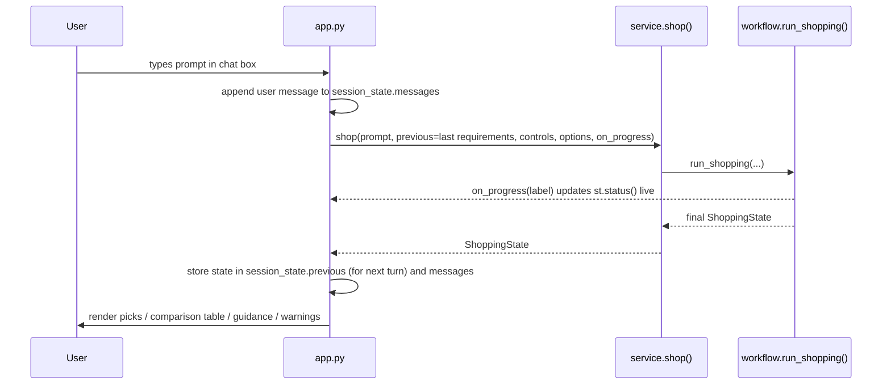

# AI Smart Shopping Agent — Project & Workflow Reference

This document describes **what the codebase actually does today**, file by file and flow by flow. For the original product spec/vision, see [AI_Smart_Shopping_Product_Research_Agent.md](AI_Smart_Shopping_Product_Research_Agent.md). This file documents the implemented system.

---

## 1. High-Level Summary

A Streamlit chat app where a user types a free-text electronics shopping request (e.g. *"Wireless headphones under USD 50 for meetings"*). A 4-stage Microsoft Agent Framework (MAF) workflow turns that into a grounded, evidence-cited shortlist of products pulled from a local Qdrant vector database — never inventing prices, specs, or reviews.



---

## 2. Tech Stack (as implemented)

| Concern | Technology | Where |
|---|---|---|
| UI | Streamlit chat UI | [app.py](app.py) |
| Orchestration | Microsoft Agent Framework (`agent_framework.WorkflowBuilder`, `Executor`, `handler`) | [src/workflow.py](src/workflow.py) |
| Chat LLM | **Azure OpenAI** via `agent_framework.openai.OpenAIChatClient` (dateless `v1` API) | [src/agents/llm_client.py](src/agents/llm_client.py) |
| Embeddings | **Ollama** `all-minilm` (384-dim, cosine) via raw HTTP `/api/embed` | [src/ingestion/embeddings.py](src/ingestion/embeddings.py) |
| Vector storage | Qdrant, embedded/local mode at `qdrant_storage/` (no Docker, no server) | [src/vector_store.py](src/vector_store.py) |
| Validation | Pydantic v2 models, many with cross-field/context validators | [src/schemas.py](src/schemas.py) |
| Testing | pytest | [tests/](tests) |

Required environment variables (`.env`, loaded via `python-dotenv`):
- `AZURE_OPENAI_ENDPOINT`, `AZURE_OPENAI_API_KEY`, `AZURE_OPENAI_DEPLOYMENT_NAME`
- `OLLAMA_BASE_URL` (optional, defaults to `http://localhost:11434`)
- `QDRANT_PATH` (optional, defaults to `<repo>/qdrant_storage`)

---

## 3. Data Layer & Ingestion Workflow

### 3.1 Sources (`Data/`)
- **`Amazon products.json`** — real scraped Amazon.com electronics listings (~1000 records: ASINs, URLs, prices, ratings, multilingual reviews). Loaded by [src/ingestion/load_amazon_json.py](src/ingestion/load_amazon_json.py). Missing fields (price, rating, etc.) are left `None`, never defaulted — "don't invent missing data" is a project-wide rule.
- **`synthetic_electronics_inventory.csv`** — explicitly fictional demo inventory used as a controlled test fixture, loaded by [src/ingestion/load_synthetic_csv.py](src/ingestion/load_synthetic_csv.py). Always tagged `is_synthetic=True` downstream and labeled "fictional demo product" in the UI.
- **Sample documents** (PDF/DOCX/CSV manuals, spec sheets) — parsed and chunked by [src/ingestion/load_documents.py](src/ingestion/load_documents.py) into `DocumentChunk` records (also synthetic).

### 3.2 Normalization
Both product loaders emit the same Pydantic `Product` schema regardless of source file, so downstream code (scoring, filtering, UI) never special-cases a data source directly — it only checks `is_synthetic` and `source_file`.

### 3.3 Ingestion pipeline (`src/ingestion/ingest.py`)


Key behaviors:
- Each point ID is a deterministic `uuid5(NAMESPACE_URL, "shopping/<collection>/<record_key>/<chunk_index>")`, so re-running ingestion is idempotent — stale chunks for a changed record are deleted via a `HasIdCondition` diff.
- Every point payload carries `record_key`, `embedding_model`, `ingested_at`, and a `freshness` flag (`"synthetic"` vs `"source_date_unknown"` — the project never claims to know real-world data freshness).
- `verify_ingestion()` is a standalone check: confirms every source record has a matching stored `record_key`, then runs a live semantic + filtered search sanity check (USD/budget/synthetic combinations) to prove retrieval works end-to-end.
- Run via: `python -m src.ingestion.ingest [--data-dir DIR] [--limit N] [--verify-only]`.

### 3.4 Qdrant collections (`src/vector_store.py`)
Three collections, all 384-dim cosine vectors: `products`, `reviews`, `documents_chunks`. `ensure_collections()` creates them if missing, or raises if an existing collection has incompatible vector settings (protects against silently mixing embedding models).

---

## 4. The 4-Agent Workflow (core business logic)

Orchestrated by `build_workflow()` / `run_shopping()` in [src/workflow.py](src/workflow.py), using MAF's `WorkflowBuilder` with conditional edges (max 8 iterations). State flows through a single immutable `ShoppingState` object ([src/state.py](src/state.py)) that each stage copies-and-updates (`model_copy(update={...})`).

### 4.1 `ShoppingState` fields
```python
user_query: str
requirement_analysis: RequirementAnalysis | None
research_result: ProductResearchResult | None
comparison_result: ComparisonResult | None
recommendation_result: RecommendationResult | None
requirement_controls: ShoppingBrief | None   # explicit UI form overrides
previous_requirements: ShoppingBrief | None  # carried over for follow-up turns
stage_timings: dict[str, float]              # per-stage perf_counter() durations
```

### Stage 1 — Requirement Analyst
**File:** [src/agents/requirement_analyst.py](src/agents/requirement_analyst.py) · **Executor:** `RequirementStep`

- Calls an Azure OpenAI agent with `response_format=RequirementAnalysis` (structured output), `temperature=0`.
- Two instruction sets: full `INSTRUCTIONS` (CLI/tests) and `FAST_INSTRUCTIONS` (used when `fast_mode=True`, i.e. the Streamlit "Detailed" toggle is off) — the fast variant is shorter/cheaper but preserves the same extraction rules.
- Extracts only *explicitly stated* facts into a `ShoppingBrief`: `category`, `budget_max`, `currency`, `use_case` (must be an exact substring of the user's message — enforced by a `model_validator`), `must_have`, `preferred_features`, `excluded_brands`, `priority_order`, `priorities` (numeric weights, only if the user gave numbers).
- Never guesses currency/country/specs; ambiguous `$`/"dollars" stays `None`.
- Retries up to `max_attempts` (default 2) on `ValidationError` / `ChatClientException` / `HTTPError` / timeout, re-prompting with a stricter instruction on retry.
- **Follow-up merging** (`_merge_requirements` in workflow.py): if there's a `previous_requirements`, the model is told the prior brief and asked to update only what changed; Python then force-preserves any field the LLM left unset, unless the category changed (which resets category-specific fields).
- **Explicit UI controls** (`_apply_controls`): sidebar form values (currency, synthetic toggle, etc.) always override the LLM's extracted values and are merged in without duplicating list entries.
- `RequirementAnalysis.status` is a **computed field**, not LLM-decided: `"needs_clarification"` if any `clarification_questions` remain (including the three generic ones Python auto-appends for missing category/budget/currency), else `"ready"`.

### Stage 2 — Product Researcher
**File:** [src/agents/product_researcher.py](src/agents/product_researcher.py) · **Executor:** `ProductResearcher` (wrapped as `ProgressResearcher`)

Only runs if Stage 1 status is `"ready"` (workflow edge condition). Pure deterministic Python + Qdrant — **no LLM call**.

1. `build_query()` concatenates category, use case, must-haves, preferred features, priority order into one string.
2. `create_query_vector()` chunks that string and embeds each chunk via Ollama, then **averages** the chunk vectors into one query vector.
3. Batched semantic search against the `products` collection (`BATCH_SIZE=64` per page, up to `max_batches=10`), filtered by Qdrant payload conditions: exact `currency` match, `price <= budget_max`, and `is_synthetic=False` unless the demo toggle is on.
4. For every candidate point, `eligible_product()` re-validates hard constraints in Python (defense in depth beyond the Qdrant filter):
   - budget/currency/category/brand-exclusion/availability/stock checks;
   - **category matching** via alias groups (e.g. "headphone/headphones/earphone/earbud/headset" all match "headphones") plus an accessory-term exclusion (won't match "headphone case" to "headphones");
   - **must-have verification**, which branches three ways:
     - *quantity requirements* like "16GB RAM" → parsed by regex into `(criterion, threshold)` and checked against normalized spec values (`measurement()` in scoring.py);
     - *boolean/connectivity features* like "wireless"/"wired"/"bluetooth" → checked against the product's `specifications` dict for supporting/contradicting values;
     - *free-text features* like a device/model compatibility phrase ("for Redmi 13 5G phone") → checked as a literal substring match against the product's name/description/features.
   - A must-have that can't be verified **excludes the product** (no benefit of the doubt).
5. Up to `MAX_EVIDENCE_PER_PRODUCT` (3) product-evidence chunks and up to 6 semantically-matched reviews (filtered to the same `product_id`/`source_file`/`is_synthetic`) are attached per surviving candidate.
6. Also retrieves up to 3 semantically related `documents_chunks` as general reference context (explicitly *not* per-product evidence).
7. Stops once `top_k` candidates are found or results are exhausted; appends warnings when fewer than `top_k` matches were found or the bounded search limit was hit (never silently returns a short list without explanation).
8. `ProductResearchResult.status` (computed): `"needs_clarification"` / `"no_matches"` / `"results"`.

### Stage 3 — Comparison & Review Analyst
**File:** [src/agents/comparison_analyst.py](src/agents/comparison_analyst.py) · **Executor:** `ComparisonReviewAnalyst` (wrapped as `ProgressComparison`)

Only runs if Stage 2 status is `"results"`.

1. **Scoring weights** (`scoring_weights()` in [src/tools/scoring.py](src/tools/scoring.py)): numeric `priorities` if given → else rank-based weights from `priority_order`/`preferred_features` (descending N..1, normalized) → else a documented default of 50% affordability / 50% rating. Priority names are normalized/aliased (e.g. `"value_for_money"` → `affordability`, `"battery_hours"` → `battery_life`) and anything that doesn't map to a recognized quantitative criterion is dropped with a warning (never silently ignored).
2. For each unique candidate (`source_file` + `product_id`), `eligible_product()` is re-checked (data may have shifted between stages) before `score_candidate()` computes a weighted score:
   - `measurement()` extracts a raw numeric value + unit for a criterion (price, rating, warranty, or a spec field like battery/RAM/storage/weight), handling unit conversion (e.g. `mAh`/`Ah`, `GB`/`TB`/`MB`, grams/kg/oz/lb) and flags conflicting source measurements as unscored rather than picking one arbitrarily.
   - `normalize_score()` maps the raw value to 0–100 using documented, hardcoded formulas (e.g. affordability = `100 * (1 - price/budget)`; weight is inverse-scaled since lower is better; others are scaled against a configurable `ScoringConfig.targets`).
   - Missing/unscorable criteria contribute **zero score, not redistributed weight** — this is called out directly in both code comments and user-facing warnings so a partial score is never confused with a "fair" comparison. `data_coverage` tracks what fraction of weight was actually backed by data.
3. **Review summarization** (`summarize_reviews()`), skipped entirely when `analyze_reviews=False` (fast mode):
   - Builds an LLM prompt from only the retrieved review snippets for *that* candidate (matching its `is_synthetic` flag), explicitly labeled as "untrusted review passages".
   - The agent returns `ReviewThemes` (topic/sentiment/citations) constrained by a strict schema: every citation's `quote` must be an exact substring of a supplied passage (`model_validator` with `context={"review_evidence": ...}`), and the quote must contain a literal keyword cue for its topic (e.g. "comfort" needs a comfort/fit/wear word) — this prevents the LLM from fabricating or mis-attributing a theme. `recurring` is computed by Python (≥2 distinct non-aggregate sources), not asserted by the LLM.
   - Retries on validation/HTTP/timeout errors; falls back to `status="unavailable"` with a warning rather than guessing.
4. Products are sorted by `(-total_score, -data_coverage, source_file, product_id)` — missing score sorts last, ties broken deterministically.
5. `ComparisonResult.status` (computed): `needs_clarification` / `no_matches` / `insufficient_data` (no product has *any* score) / `results`.

### Stage 4 — Recommendation Assistant
**File:** [src/agents/recommendation_assistant.py](src/agents/recommendation_assistant.py) · **Executor:** `RecommendationAssistant` (wrapped as `ProgressRecommendation`)

1. `select_picks()` deterministically (no LLM) chooses up to 3 distinct products: `best_overall` (top score), `best_value` (highest `score/price` among remaining priced items), `best_alternative` (next remaining). Each role maps to a distinct product — never duplicates.
2. For each pick, reasoning is either:
   - **Fast mode** (`fast_reasons()`): built directly from criterion scores with no LLM call — e.g. `"Battery life: 72.0/100 under the configured scoring policy."`
   - **Detailed mode** (`explain_pick()`): an LLM call constrained to a `ReasonsOnly` schema (`max 4 reasons`), where every reason must cite an *existing* criterion name or review topic from that product's evidence, and a `model_validator` in `RecommendationReason` enforces that `strength` reasons only cite scores ≥50/positive themes and `trade_off` reasons only cite scores <50 (or missing)/negative-mixed themes — the LLM cannot invent a strength for a weak criterion or vice versa.
3. Builds the full `comparison_table` (`ComparisonRow` per compared product, regardless of whether it was picked) so the UI can show all candidates, not just the top 3.
4. `RecommendationResult.status` (computed): `needs_clarification` / `no_matches` / `insufficient_data` / `results`.

### Fallback — Buying Guidance
**File:** [src/agents/buying_guidance.py](src/agents/buying_guidance.py) · **Executor:** `GuidanceStep` (only wired when `enable_guidance=True`, which `service.py` always sets)

Triggered when:
- Stage 2 returns `no_matches` (no products at all), or
- Stage 4 returns `insufficient_data` (products exist but nothing was scorable).

Calls an LLM constrained to `GuidanceTopics` (1–5 generic buying-criteria topics, e.g. "check battery life rating"), explicitly instructed to **never recommend a named product or invent specs/prices/reviews**. On any LLM failure, falls back to two hardcoded generic tips with `used_llm=False`. The result is clearly labeled `"General buying guidance, not verified product recommendations"` in both the schema default and the UI (`app.py` renders it in a separate box from product picks).

### Workflow edges (conditional routing)

`FinishStep` guarantees the workflow always `yield_output`s exactly one `ShoppingState` — if `recommendation_result` was never set (e.g. clarification needed before research even ran), it synthesizes a minimal `RecommendationResult` carrying the clarification questions/warnings so the UI never has to special-case a missing result.

---

## 5. Application / UI Flow

### 5.1 `src/service.py` — thin adapter
`shop(query, previous, controls, options, on_progress)` wraps `run_shopping()`, translating a simple `ShoppingOptions` dataclass (`include_synthetic`, `detailed`, `top_k`) into the workflow's keyword arguments (`fast_mode = not detailed`, `enable_guidance=True` always).

### 5.2 `app.py` — Streamlit chat loop


Sidebar controls (all map to real workflow parameters, nothing is cosmetic-only):
- **Detailed AI explanations and review analysis** toggle → `fast_mode` (off = deterministic-only, much faster; on = LLM review themes + LLM reason explanations).
- **Include fictional demo products** toggle → `include_synthetic` (shows a warning banner when on).
- **Currency** selector → overrides `ShoppingBrief.currency` via `requirement_controls`, bypassing ambiguous LLM extraction.
- **New conversation** button → clears `messages`/`previous`, resetting multi-turn context.

Rendering (`show_result()` in app.py, mirrored by the more detailed helpers in [src/ui/presentation.py](src/ui/presentation.py) which the main chat loop doesn't currently import but ships as the more polished/independent rendering module):
- Narrative summary text (`answer_text()` — maps `status` to a user-facing sentence, including explicit "I couldn't verify..." language rather than ever claiming success it can't back up).
- General guidance block, shown separately from product picks when present.
- One card per pick: name, price, score, **evidence coverage %**, a "Fictional demo product" warning if synthetic, a source link button, ✓/△ marked reasons, and an expandable "Limitations" list of caveats.
- An expandable full comparison table (all compared products, not just picks).
- An expandable "Data quality and sources" panel listing every warning plus, per product, every evidence point's `source_file` / `point_id` / `freshness`.
- Suggested next steps and a JSON export button (`result.model_dump_json()`) for the full structured `RecommendationResult`.

---

## 6. Data & Schema Reference (`src/schemas.py`)

Core record types:
- **`Product`** — normalized listing (price/currency/rating/specs/features/etc.), always tagged with `source_name`/`source_file`/`dataset_snapshot`.
- **`Review`** — individual or `is_aggregate` review record.
- **`DocumentChunk`** — pre-embedding chunk of a parsed PDF/DOCX/CSV source.

Request/brief types:
- **`ShoppingBrief`** — the structured user ask (category, budget, currency, must-haves, priorities, etc.); `extra="forbid"` so the LLM can't smuggle extra fields. `priorities` are auto-normalized to sum to 1 via a `field_validator`.
- **`RequirementAnalysis`** — wraps a `ShoppingBrief` + clarification questions + a `status` computed field; a `model_validator` enforces that `use_case` is an exact excerpt of the original query (anti-hallucination guard).

Pipeline result types (each with a `status` **computed field** so routing logic never depends on free-text LLM output):
- **`ProductResearchResult`** → `ResearchCandidate` (product + retrieval score + evidence + verified features) and `ResearchEvidence` (point id, text, source file, freshness, synthetic/aggregate flags).
- **`ComparisonResult`** → `ComparedProduct` (criteria scores + review summary + warnings), `CriterionScore` (value/unit/score/contribution/method/evidence — the *method* string is always present so every number is explainable), `ReviewSummary`/`ReviewTheme`/`ReviewCitation` (citation-grounded, see Stage 3 above).
- **`RecommendationResult`** → `ProductRecommendation` (role/reasons/caveats), `ComparisonRow` (flat table row), `BuyingGuidance` (fallback advice).

This schema-first design means almost every "trust boundary" (LLM output, review text, prior turn state) is validated by a Pydantic model with custom validators rather than by ad hoc code — e.g. an LLM cannot claim a review theme it didn't quote, cannot call a weak criterion a "strength", and cannot report readiness without the three essential fields being non-null.

---

## 7. Testing

- [tests/test_core.py](tests/test_core.py) — core schema/workflow unit tests.
- [tests/test_scoring_smoke.py](tests/test_scoring_smoke.py) — smoke tests for the deterministic scoring module.

Run with `python -m pytest -q` (or `--junit-xml=result.xml` for reliable output capture on this machine, per environment notes).

---

## 8. Running the Project

```powershell
# 1. Ingest data into local Qdrant storage (run once, or after Data/ changes)
python -m src.ingestion.ingest

# 2. Verify ingestion + retrieval work end-to-end
python -m src.ingestion.ingest --verify-only

# 3. Launch the chat UI
streamlit run app.py
```

Individual agents are also runnable standalone for debugging, e.g.:
```powershell
python -m src.agents.requirement_analyst "Find wireless headphones under USD 100."
python -m src.agents.product_researcher --category keyboards --budget 5000 --currency INR --must-have wireless --include-synthetic
python -m src.agents.comparison_analyst --category headphones --budget 100 --currency USD --must-have wireless --top-k 3
python -m src.agents.recommendation_assistant --category headphones --budget 100 --currency USD --must-have wireless --top-k 5
```

---

## 9. Design Principles Reflected in the Code

1. **No invented facts.** Missing prices/specs/reviews stay `None`/empty and are surfaced as warnings, never defaulted or guessed.
2. **LLM does interpretation, Python does arithmetic and routing.** All scores, status fields, and workflow edges are deterministic; the LLM only extracts structure, summarizes *given* text, or explains *already-computed* scores.
3. **Every claim is grounded and traceable.** Review themes must quote exact supplied text; recommendation reasons must cite an existing criterion/topic; every evidence item carries its `source_file`/`point_id`/`freshness`.
4. **Synthetic vs. real data is never blurred.** `is_synthetic` is threaded through ingestion, retrieval, scoring, and the UI (explicit "Fictional demo product" warnings).
5. **Graceful degradation over silent failure.** LLM timeouts/validation errors retry once with a stricter prompt, then fail over to a deterministic or generic-guidance path — the workflow always finishes with a valid, explainable result.
