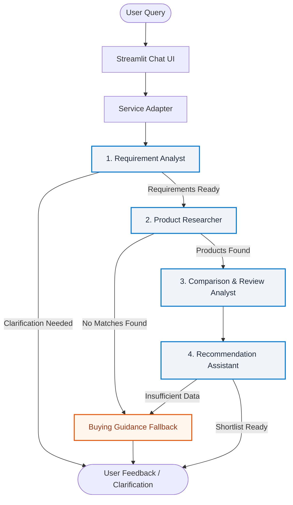

# 🛍️ AI Smart Shopping & Product Research Agent

[](https://www.python.org/)
[](https://github.com/microsoft/agent-framework)
[](https://streamlit.io/)
[-DC2626.svg?logo=qdrant&logoColor=white)](https://qdrant.tech/)
[-000000.svg?logo=ollama&logoColor=white)](https://ollama.ai/)
[-008AD7.svg?logo=openai&logoColor=white)](https://azure.microsoft.com/)

A multi-agent conversational shopping assistant for consumer electronics that delivers **verifiable, evidence-backed product recommendations**. 

Unlike standard LLM chatbots that frequently hallucinate prices, specifications, and user reviews, this system relies on a **4-stage Microsoft Agent Framework (MAF) workflow**, strict **Pydantic v2 schemas**, deterministic constraint matching, and a local **embedded Qdrant vector database**. Every recommendation, strength, trade-off, and review theme is grounded in ingested product records with verbatim source citations.

---

## 🌟 Key Features

* **🛡️ Zero-Hallucination Policy**: Prices, availability, specs, and reviews are never invented. If data is missing or cannot be verified, it is left unset and flagged with explicit user warnings.
* **🤖 4-Stage Multi-Agent Architecture**:
  1. **Requirement Analyst**: Extracts budget, currency, category, hard constraints, and priorities with strict query-substring validation and follow-up merging.
  2. **Product Researcher**: Deterministic semantic search + Python-level constraint enforcement (budget, category aliases, accessory exclusions, battery/RAM regex parsing).
  3. **Comparison & Review Analyst**: Formulaic 0–100 criterion scoring with unit normalization (`mAh`, `GB`, `kg`, etc.) and citation-grounded review summarization.
  4. **Recommendation Assistant**: Selects top picks (*Best Overall*, *Best Value*, *Best Alternative*) and generates evidence-linked strengths and trade-offs.
* **🧭 Fallback Buying Guidance**: When products cannot be found or data is unverified, the system transitions to unbiased buying guidance instead of guessing.
* **⚡ Dual-Mode Execution**:
  * **Fast Mode**: Deterministic scoring and rule-based explanations for rapid sub-second responses.
  * **Detailed Mode**: Full LLM-based sentiment review summarization and deep comparative reasoning.
* **🗄️ Fully Local Vector Storage**: Uses embedded Qdrant storage (`qdrant_storage/`) and local Ollama embeddings—no Docker or external database servers required.
* **📊 Comprehensive UI**: Interactive Streamlit interface with live stage progression, comparison tables, data coverage percentages, evidence inspector, and JSON export.

---

## 🏗️ Architecture & Workflow

The orchestration pipeline is built using **Microsoft Agent Framework (`agent_framework.WorkflowBuilder`)** with conditional routing:



### Workflow Stages at a Glance

| Stage | Component | Core Responsibility | Model / Engine |
|---|---|---|---|
| **1** | **Requirement Analyst** | Parses natural language into a validated `ShoppingBrief`. Enforces use-case validation, manages multi-turn context updates, and triggers clarifications. | Azure OpenAI (Structured Outputs) |
| **2** | **Product Researcher** | Hybrid semantic vector search + deterministic hard filters (budget, currency, specs, category aliases, accessory filters). | Ollama (`all-minilm`) + Qdrant |
| **3** | **Comparison Analyst** | Normalizes units, calculates weighted scores (0–100), tracks data coverage %, and extracts verified review citations. | Deterministic scoring + Azure OpenAI |
| **4** | **Recommendation Assistant** | Assigns deterministic roles (*Best Overall*, *Best Value*, *Best Alternative*) and pairs evidence-backed reasons and caveats. | Deterministic picks + Azure OpenAI |
| **Fallback** | **Buying Guidance** | Supplies generic purchasing advice and checklist points if no inventory matches the criteria. | Azure OpenAI / Rule fallback |

---

## 📂 Project Structure

```text
AI-Smart_Shopping_Agent/
├── Data/                              # Ingestion datasets
│   ├── Amazon products.json           # Real scraped Amazon electronics listings & reviews
│   └── synthetic_electronics_inventory.csv # Controlled synthetic demo inventory
├── qdrant_storage/                    # Local embedded Qdrant vector store
├── src/
│   ├── agents/                        # Agent implementations & LLM wrappers
│   │   ├── llm_client.py              # Azure OpenAI client configuration
│   │   ├── requirement_analyst.py     # Stage 1: Structured requirement extraction
│   │   ├── product_researcher.py      # Stage 2: Qdrant vector search & constraint filter
│   │   ├── comparison_analyst.py      # Stage 3: Scoring, units, review extraction
│   │   ├── recommendation_assistant.py# Stage 4: Pick selection & grounded explanations
│   │   └── buying_guidance.py         # Fallback: General purchasing advice
│   ├── ingestion/                     # Document & catalog ingestion pipeline
│   │   ├── ingest.py                  # Ingestion orchestrator & verification CLI
│   │   ├── embeddings.py              # Ollama embedding client
│   │   ├── load_amazon_json.py        # Amazon catalog parser
│   │   ├── load_synthetic_csv.py      # Synthetic demo inventory parser
│   │   ├── load_documents.py          # PDF/DOCX/CSV manual ingestion
│   │   └── text_processing.py         # Chunking and text normalization
│   ├── tools/
│   │   └── scoring.py                 # Mathematical scoring & unit conversion formulas
│   ├── ui/
│   │   └── presentation.py            # Result formatting and UI helpers
│   ├── schemas.py                     # Pydantic v2 data models & validation guards
│   ├── service.py                     # High-level async interface for the UI
│   ├── state.py                       # Immutable ShoppingState definition
│   ├── vector_store.py                # Qdrant client & collection management
│   └── workflow.py                    # Microsoft Agent Framework workflow graph
├── tests/                             # Unit & integration test suite
│   ├── test_app.py
│   ├── test_comparison_analyst.py
│   ├── test_core.py
│   ├── test_ingestion.py
│   ├── test_product_researcher.py
│   ├── test_recommendation_assistant.py
│   ├── test_requirement_analyst.py
│   ├── test_scoring.py
│   ├── test_vector_store.py
│   └── test_workflow.py
├── app.py                             # Streamlit application entrypoint
├── PROJECT_WORKFLOW.md                # Comprehensive technical specification
├── requirements.txt                   # Project dependencies
└── .env                               # Environment configuration (ignored in git)
```

---

## 🛠️ Tech Stack & Requirements

* **Python**: 3.10 or higher
* **LLM**: **Azure OpenAI** (`gpt-4o` deployment with structured outputs)
* **Embedding Model**: **Ollama** running `all-minilm` (384-dimensional cosine embeddings)
* **Vector Store**: **Qdrant** (running embedded in local folder mode)
* **Agent Framework**: **Microsoft Agent Framework** (`agent-framework`)
* **Web UI**: **Streamlit**

---

## 🚀 Getting Started

### 1. Clone the Repository

```bash
git clone https://github.com/<your-username>/AI-Smart_Shopping_Agent.git
cd AI-Smart_Shopping_Agent
```

### 2. Set Up a Virtual Environment

```bash
# Windows (PowerShell)
python -m venv venv
.\venv\Scripts\Activate.ps1

# Linux / macOS
python3 -m venv venv
source venv/bin/activate
```

### 3. Install Dependencies

```bash
pip install -r requirements.txt
```

### 4. Configure Environment Variables

Create a `.env` file in the root directory:

```env
# Azure OpenAI Credentials
AZURE_OPENAI_ENDPOINT=https://<your-resource-name>.openai.azure.com/
AZURE_OPENAI_API_KEY=<your-azure-api-key>
AZURE_OPENAI_DEPLOYMENT_NAME=gpt-4o
AZURE_OPENAI_API_VERSION=2024-10-21

# Optional overrides (defaults shown)
OLLAMA_BASE_URL=http://localhost:11434
QDRANT_PATH=./qdrant_storage
```

> [!IMPORTANT]
> Never commit your `.env` file with production API keys to GitHub. Keep `.env` listed in `.gitignore`.

### 5. Start Ollama and Pull the Embedding Model

Make sure [Ollama](https://ollama.ai/) is installed and running:

```bash
# Pull the required 384-dimension embedding model
ollama pull all-minilm

# Ensure Ollama server is running (default: http://localhost:11434)
ollama serve
```

---

## 📥 Data Ingestion

The repository includes tools to ingest Amazon product listings, synthetic catalogs, and technical documents into Qdrant.

To run the ingestion pipeline:

```bash
# Run complete ingestion
python -m src.ingestion.ingest

# Limit the number of records (for quick test setup)
python -m src.ingestion.ingest --limit 100

# Verify existing vector database without re-ingesting
python -m src.ingestion.ingest --verify-only
```

* **Idempotency**: Point IDs are generated via deterministic `uuid5`, making repeated ingestion runs safe and idempotent.
* **Integrity**: Existing outdated chunks for the same record are automatically cleaned up during re-ingestion.

---

## 🖥️ Running the Application

Launch the Streamlit web application:

```bash
streamlit run app.py
```

Open your browser at `http://localhost:8501`.

### Example Queries to Try:
* *"Wireless noise-canceling headphones under USD 80 for office meetings"*
* *"Lightweight laptop with 16GB RAM under USD 700 for programming"*
* *"Fast charging power bank under USD 30"*

### Streamlit Controls
* **Detailed AI explanations and review analysis**: Toggle off for ultra-fast, deterministic rule-based output; toggle on for in-depth review theme citations.
* **Include fictional demo products**: Toggle whether synthetic test items should be surfaced alongside verified products.
* **Currency selector**: Force a specific currency or allow the Requirement Analyst to infer it from the user query.
* **Export JSON**: Download the full structured `RecommendationResult` payload for external processing or evaluation.

---

## 🧪 Testing

The project has comprehensive test coverage across agents, data ingestion, scoring algorithms, and the end-to-end workflow:

```bash
# Run the complete test suite
pytest

# Run tests with verbose output
pytest -v

# Run smoke tests for scoring calculations
pytest tests/test_scoring_smoke.py
```

---

This project is licensed under the [MIT License](LICENSE) (or your preferred repository license).
